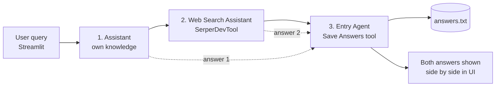

# 🤝 Multi-Agent Customer Support (CrewAI + Streamlit)

**Social Eagle · Gen AI Architect Program · Weekly Buildathon**
Author: **Ganapathyraman**

A customer support system made of **three agents that run one after another** using CrewAI's
**sequential** process, with a **Streamlit** front end. A query goes in; the first agent answers it
from its own knowledge, the second searches the web and answers from the results, and the third
saves everything to `answers.txt` and returns both answers to the UI.

---

## How it works



| # | Agent | Tool | What it does |
|---|-------|------|--------------|
| 1 | **Assistant** | none | Answers the query directly from its own knowledge |
| 2 | **Web Search Assistant** | `SerperDevTool` | Searches the web and answers only from the results, with sources |
| 3 | **Entry Agent** | `Save Answers To File` (custom) | Writes query + answer 1 + answer 2 to `answers.txt`, returns both answers |

### Design decisions ("Think it through")

- **Passing data along** – the query enters once through `crew.kickoff(inputs={"query": ...})` and
  is filled into every task's `{query}` placeholder. The Entry task declares
  `context=[assistant_task, web_search_task]`, so it receives **both** earlier answers before it writes the file.
- **Independent answers** – the Web Search task sets `context=[]`, so it does not see Answer 1.
  This keeps the two answers genuinely independent (knowledge vs. web), which makes the comparison meaningful.
- **Who holds the web tool** – only the Web Search Assistant has `SerperDevTool`. The Assistant has no
  tools; the Entry Agent has only the file-writing tool.
- **Returning both answers** – the Entry task uses `output_pydantic=SupportResponse`, so it hands
  back a structured object (query, answer 1, answer 2, file name) that the UI renders in two columns.
  If structured parsing ever fails, the app falls back to the raw outputs of tasks 1 and 2.
- **While the crew is running** – a `task_callback` updates a live `st.status` panel
  (Assistant answering → Web Search Assistant searching → Entry Agent saving). Full agent reasoning
  is also printed in the terminal (`verbose=True`).
- **Secrets** – API keys are read from environment variables loaded from a local `.env` file
  (`python-dotenv`). `.env` is in `.gitignore`; only `.env.example` (placeholders) is committed.

---

## Project structure

```
.
├── app.py             # all code: agents, tasks, crew, Streamlit UI
├── requirements.txt   # Python dependencies
├── .env.example       # template for your API keys (safe to commit)
├── .env               # your real keys (NOT committed - in .gitignore)
├── .gitignore
├── README.md
└── answers.txt        # created by the Entry Agent at runtime (not committed)
```

---

## Setup

Requires **Python 3.11 – 3.13** (CrewAI does not support 3.14 yet).

```bash
# 1. Clone this repository (copy the URL from the green "Code" button) and enter the folder
git clone <repository-url>
cd <repository-folder>

# 2. Create and activate a virtual environment
python -m venv venv
source venv/bin/activate          # macOS / Linux
venv\Scripts\Activate.ps1         # Windows PowerShell

# 3. Install dependencies
pip install -r requirements.txt

# 4. Add your API keys
cp .env.example .env              # macOS / Linux
copy .env.example .env            # Windows
# then open .env and paste your OpenAI and Serper keys

# 5. Run
streamlit run app.py
```

The app opens at <http://localhost:8501>.

- OpenAI key: <https://platform.openai.com/api-keys>
- Serper key (web search): <https://serper.dev>

---

## Example flow

1. User enters: *How do I reset my password?*
2. Assistant answers directly
3. Web Search Assistant searches the web and answers
4. Entry Agent writes the query + both answers to `answers.txt`
5. UI shows both answers side by side

---

## Tech stack

Python · CrewAI · crewai-tools (SerperDevTool) · Streamlit · OpenAI (`gpt-4o-mini` by default) · python-dotenv
